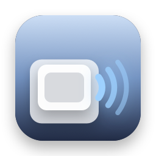
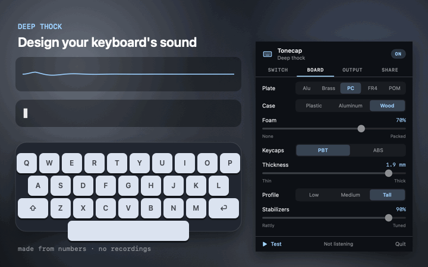
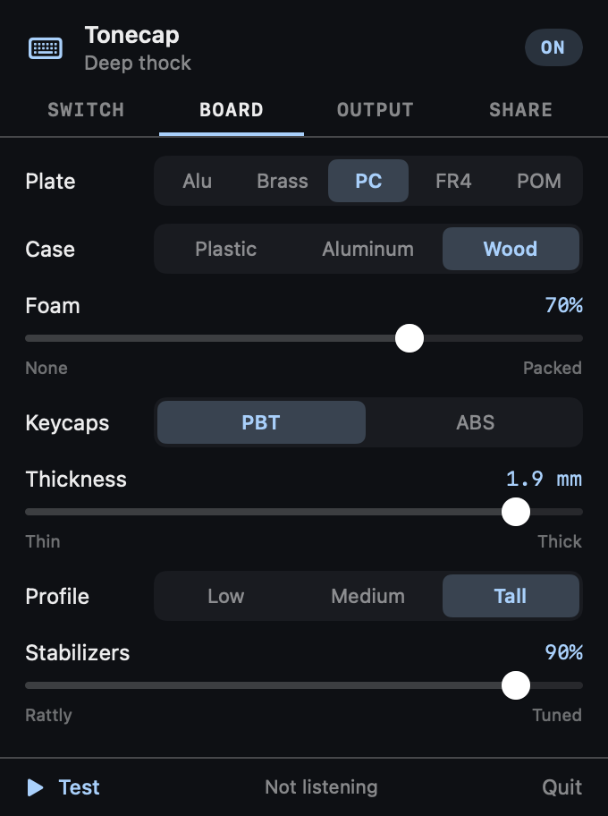
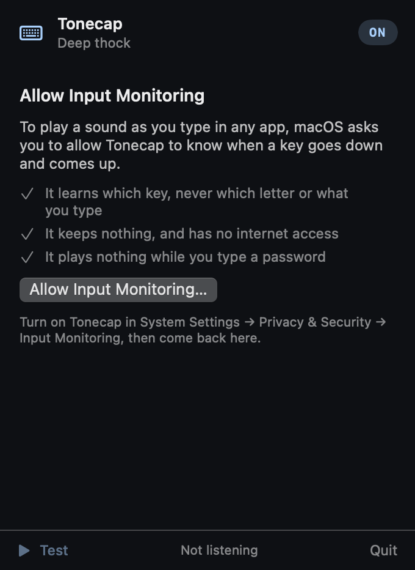

<p align="center">
  
</p>

<h1 align="center">Tonecap</h1>

<p align="center">
  <b>Design your keyboard's sound.</b><br>
  Mechanical keyboard sounds made from numbers, with no recordings. Pick a switch, a plate, a case and keycaps in a free web playground, type to hear it and share the link. A free Mac menu bar app plays your sound as you type, anywhere.
</p>

<p align="center">
  <a href="https://stanczykwyatt.github.io/tonecap/"><b>Open the playground</b></a>
  &nbsp;·&nbsp;
  <a href="https://github.com/stanczykwyatt/tonecap/releases/latest/download/Tonecap.zip"><b>Download for Mac</b></a>
  &nbsp;·&nbsp;
  <a href="https://github.com/users/stanczykwyatt/projects/1">Roadmap</a>
  &nbsp;·&nbsp;
  <a href="https://github.com/stanczykwyatt/tonecap/discussions">Discussions</a>
</p>

<p align="center">
  <a href="https://github.com/stanczykwyatt/tonecap/actions/workflows/ci.yml"></a>
  <a href="https://github.com/stanczykwyatt/tonecap/releases/latest"></a>
  
  
  
  
  <a href="LICENSE"></a>
</p>

<p align="center">
  
</p>

---

Most keyboard sound apps play recordings. That's fine until you want to know what *your* build would sound like: a heavier spring, a brass plate, more foam, thicker caps.

Tonecap builds the sound instead. A key press is a few small events (the stem scraping its housing, a tactile bump or a click, the stem bottoming out, the stabilizer wires knocking), and each one rings tuned resonators standing for the keycap, the plate, the case, the desk and the spring. Change a material and the pitch, the ring and the level change with it. Every press is a little different, so fast typing doesn't sound like a loop.

It's a model to play with, not a copy of any real keyboard. Honestly: it won't fool a recording, but it answers "what if" in a way recordings can't.

If you like the sound of it, [starring the repo](https://github.com/stanczykwyatt/tonecap/stargazers) helps other people find it.

## The playground

[stanczykwyatt.github.io/tonecap](https://stanczykwyatt.github.io/tonecap/) runs in any modern browser, on phones too.

- **Sliders and presets** for the switch (linear, tactile or clicky, spring, lube, bottom-out, top-out) and the board (plate, case, foam, keycap material, thickness and profile, stabilizers).
- **Type in the test box** to hear it, or play a sample line.
- **The whole build is in the link.** Copy it and anyone opens the same sound. It travels after the `#`, which browsers never send to a server.
- **A/B comparison:** two builds in one link, switched with a click while you type.
- **WAV export** of what you just typed, or the sample line, in stereo.
- **Wide keys sound deeper,** stabilizers can rattle, and each key sits where it would on a real board, left to right.

The page loads only its own files, makes no network requests and keeps nothing.

## The Mac app



A menu bar app that plays your sound as you type in any app.

- **The same engine and settings,** in a dark panel with tabs, and the same presets.
- **Paste a link** from the playground to bring a build across, or copy yours out.
- **Volume, ⌃⌥M to mute** from anywhere, and quiet in the apps you pick, like a video call.
- **Releases and held keys** can be on or off.
- **Fast:** every sound is rendered ahead of time, so a key press only hands a buffer to a player that's already running, on a cycle of 128 frames (under 3 ms at 48 kHz) plus your output device's own delay.
- **Private:** it learns which key went down or up, never which letter, and plays nothing in password fields. No internet access.

<br clear="right">

### Install

1. [Download **Tonecap.zip**](https://github.com/stanczykwyatt/tonecap/releases/latest/download/Tonecap.zip) and unzip it.
2. Move **Tonecap** to your Applications folder and open it.
3. Click **Allow Input Monitoring…** and switch on Tonecap in **System Settings → Privacy & Security → Input Monitoring**.
4. Type anywhere.



> **Why Input Monitoring?** It's how macOS lets an app know a key went down or came up while another app is in front. Tonecap reads three things from each event: the key code (which key, not which character), whether it's an auto-repeat, and which modifier keys are held. It never reads characters, can't change or block a key, keeps nothing and has no internet access. It plays nothing while secure input is on, as in password fields. [SECURITY.md](SECURITY.md) has the details.

> **About the security warning:** The first time you open Tonecap, macOS may say Apple couldn't verify that it's free of malware. It shows up because the app isn't notarized yet: Apple charges developers $99 a year for that, and this project hasn't paid the fee. The code is fully open source, so you can read every line or build the app yourself. To open it, go to **System Settings → Privacy & Security** and click **Open Anyway**.

> **After an update:** allow Input Monitoring again for the new version. In **System Settings → Privacy & Security → Input Monitoring**, select Tonecap, click **–**, then open Tonecap and click **Allow Input Monitoring…**. macOS ties the permission to each exact build, which keeps any other program from borrowing it.

> **Can't see the icon?** On a MacBook with a camera notch, menu bar icons that don't fit are hidden behind it. Hold ⌘ and drag the icon to the right, or quit a menu bar app you don't need.

### Build from source

You need macOS 14 or later and Swift 6, which comes with Xcode 16 or the Command Line Tools.

```bash
git clone https://github.com/stanczykwyatt/tonecap.git
cd tonecap
scripts/build-app.sh
open build/Tonecap.app
```

## The engine

One dependency-free JavaScript file, [`docs/engine/tonecap.js`](docs/engine/tonecap.js), with a line-by-line Swift port in [`Sources/ToneCore`](Sources/ToneCore). The tests check the two render the same samples to within rounding.

```js
import { PRESETS, render, encode, decode } from "./tonecap.js";

const design = PRESETS[0].design;                     // or decode("AQA3VTcjAgJGAFoCWkI")
const press = render(design, 1, 0, false, 48000);     // a letter key, variant 0, going down
const release = render(design, 6.25, 3, true, 48000); // the spacebar coming back up
const link = "https://stanczykwyatt.github.io/tonecap/#s=" + encode(design);
```

[CONTRIBUTING.md](CONTRIBUTING.md) explains the model and how to change it.

## Privacy and security

Tonecap is built so it has no way to misuse what it hears, and CI checks every build for that, not just a promise.

- **Key codes only.** From each key event the app reads the key code, the auto-repeat flag and the modifier flags. CI checks that nothing else is read from an event and that nothing that turns a key into a character is used anywhere.
- **Listen-only.** Its one event tap can't change, block or add keys, and it never posts an event.
- **Keeps nothing.** No log of keys, no file written; its settings go to its preferences.
- **No internet access.** It has no networking code, so it never connects to anything. The playground link it opens is the project's own page, with the sound after the `#`.
- **Silent during secure input.** While a password field or Terminal's Secure Keyboard Entry has secure input on, it plays nothing at all.
- **No entitlements and no dependencies.** Every line that runs is in this repository. CI checks the source and the built app of every build, and each release's download is built by CI from the tagged source, with its code hash attached so you can compare.

Check the app's permissions yourself with `codesign -d --entitlements - /Applications/Tonecap.app`, which prints none. The full details are in [SECURITY.md](SECURITY.md).

## FAQ

**Are these real recordings of keyboards?**
No. Every sound is made from numbers. It's a model you can play with, not a copy of any particular keyboard.

**Is this a Mechvibes alternative?**
It does the same job, playing keyboard sounds as you type, in a different way: apps like Mechvibes play recorded sound packs, while Tonecap builds the sound from settings you can change.

**Why does it go quiet when I type a password?**
Password fields turn on macOS's secure input, and Tonecap plays nothing while it's on, not even modifier keys. A password typed somewhere without secure input, like `sudo` in a terminal without Secure Keyboard Entry, plays like any other typing; even then, Tonecap only learns which keys moved, never the letters.

**Does it work with any keyboard?**
Yes, built-in or external. Key positions follow a US layout; keys it doesn't know, like a numeric keypad, sound like a letter key in the middle.

**Does it use much battery?**
Very little. Sounds are rendered once, when you change the design. The audio engine stops after two minutes without a key, so it isn't keeping your speakers awake; the first key after that plays a moment late while the audio starts again.

**Does it work on Intel Macs?**
Yes. The download runs on Apple silicon and Intel Macs with macOS 14 Sonoma or later.

## More free tools

**Mac apps**

- **[Show Desktop](https://github.com/stanczykwyatt/show-desktop):** hide every window with one click or ⌃⇧D, then bring them all back exactly as they were.
- **[Copy 2FA](https://github.com/stanczykwyatt/copy-2fa):** copy 2FA codes from Mail, Messages or a built-in authenticator with one keyboard shortcut.
- **[Who Stole My Focus](https://github.com/stanczykwyatt/who-stole-my-focus):** find out which app keeps jumping in front of your work.
- **[AI Footprint](https://github.com/stanczykwyatt/ai-footprint):** see what AI coding tools leave on your Mac, and what each update changed.
- **[Memo Export](https://github.com/stanczykwyatt/memo-export):** export your Voice Memos transcripts as Markdown, with the audio.
- **[Podcast Export](https://github.com/stanczykwyatt/podcast-export):** export your Apple Podcasts shows as OPML, and your listening history.
- **[Reading List Export](https://github.com/stanczykwyatt/reading-list-export):** export your Safari Reading List as Markdown, bookmarks and CSV.
- **[Unblock Eject](https://github.com/stanczykwyatt/unblock-eject):** see what's keeping your disk from ejecting, and quit it politely.
- **[Next Departures](https://github.com/stanczykwyatt/next-departures):** your stop's next bus and train, live, in the menu bar.
- **[Right Folder](https://github.com/stanczykwyatt/right-folder):** Open and Save dialogs, in the right folder. A free Default Folder X alternative.
- **[SciLook](https://github.com/stanczykwyatt/scilook):** Quick Look for NWB, HDF5, MATLAB and NumPy files on your Mac.

**Windows**

- **[Who Stole My Focus for Windows](https://github.com/stanczykwyatt/who-stole-my-focus-windows):** the focus-thief finder as a Windows tray app (preview).

**For coding agents**

- **[mulligan](https://github.com/stanczykwyatt/mulligan):** undo for coding agents: snapshots at every prompt and tool call, for macOS and Linux.
- **[symbolhop](https://github.com/stanczykwyatt/symbolhop):** go-to-definition and find-references for coding agents, from your language servers.

**For neuroscience data**

- **[brainhound](https://github.com/stanczykwyatt/brainhound):** search and read public neuroscience data from your coding agent or terminal.
- **[dropslice](https://stanczykwyatt.github.io/dropslice/):** open NWB, HDF5, MATLAB, NumPy and Zarr files in your browser.

**On the web**

- **[Openfume](https://stanczykwyatt.github.io/openfume/):** an open fragrance database you can search by notes and accords.

Next Departures fetches only the transit feeds you pick, brainhound reads only public neuroscience archives, and dropslice and Openfume are web pages that never upload your files. The rest have no internet access.

## Contributing

Contributions are welcome, especially ears: if a material or switch sounds wrong to you, say how in [Discussions](https://github.com/stanczykwyatt/tonecap/discussions), with a link to the build. See [CONTRIBUTING.md](CONTRIBUTING.md), and the [roadmap](https://github.com/users/stanczykwyatt/projects/1) for what's planned.

## License

Tonecap is released under the [MIT License](LICENSE) and is provided as is, without warranty of any kind.

Tonecap is an independent project. It contains no recorded sounds: every sound is synthesized by the code in this repository. Preset names describe how they sound and aren't any product's. It isn't affiliated with, endorsed by or sponsored by Apple Inc. or the makers of any keyboard, switch or sound app; Mechvibes is named only to say what Tonecap is an alternative to. Apple, Mac and macOS are trademarks of Apple Inc., registered in the U.S. and other countries. Other product names belong to their owners. The words typed in the demo are made up.
